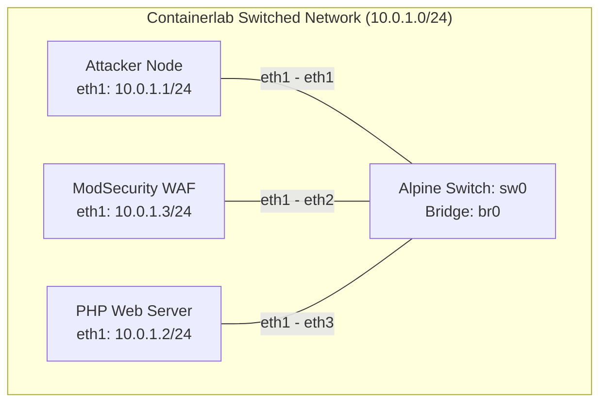

# modsec-php-lab
## Obective:
In this lab, I design, deploy, and verify a Layer 7 Web Application Firewall (WAF) using ModSecurity, NGINX, and Containerlab. I configured an isolated switched network topology (`sw0`) connecting an attacker node, a WAF proxy, and a backend vulnerable PHP application (`php:8.2.34-apache`) matching the following topology:


---
## Requirements to Demo this Lab
This lab was created inside Containerlabs and is meant to be run within Linux or WSL. The required files are included in the repository.

# Running the Lab
## Building the Custom Images
This lab makes use of two custom Docker images. The following commands must be entered before deploying the lab:
```
docker build -t custom-php:latest ./images/php
```
```
docker build -t custom-waf:latest ./images/modsec
```

## Deploying the Lab
Open Containerlabs and navigate to the downloaded YAML file, then run the following command:
```
sudo containerlab deploy -t topology.clab.yml
```

## Testing the ModSecurity rules
To test that the provided attacks are being protected against using ModSecurity while not preventing regular traffic, run the following test commands in the WSL terminal to see that the ModSecurity rules are properly set up:

### Test 1: Legitimate Traffic (`404 OK`)
Verify that standard traffic reaches the backend PHP application successfully through the WAF.
```bash
docker exec -it clab-modsec-php-lab-attacker curl -i -X GET "http://10.0.1.3:8080/index.php?page=home"
```
* **Expected Output:** `HTTP/1.1 404`

### Test 2: Non-Canonical Multipart Content-Type (`403 Forbidden`)
Test your custom ModSecurity rules by submitting a simulated multi part content type post request.
```bash
docker exec -it clab-modsec-php-lab-attacker curl -i -X POST "http://10.0.1.3:8080/" \
     -H "Content-Type: multipart/form-data,boundary=something" \
     -F "test=value"
```
* **Expected Output:** `HTTP/1.1 403 Forbidden`

### Test 3: PHP Session Upload Progress Field (`403 Forbidden`)
Verify that php session upload parameters are blocked by your rule set.
```bash
docker exec -it clab-modsec-php-lab-attacker curl -i -X POST "http://10.0.1.3:8080/" \
     -F "php_session_upload_progress=exploit_payload"
```
* **Expected Output:** `HTTP/1.1 403 Forbidden`


---


## Destroying the Lab
Once you've finished with the lab, run the following command to destroy and clean-up:
```
sudo containerlab destroy -t topology.clab.yml
```